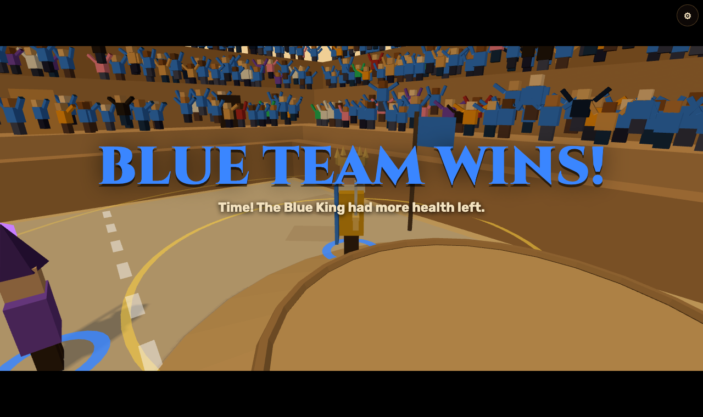
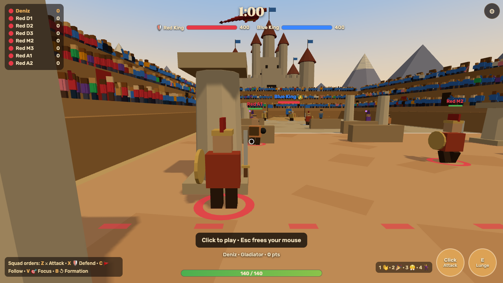
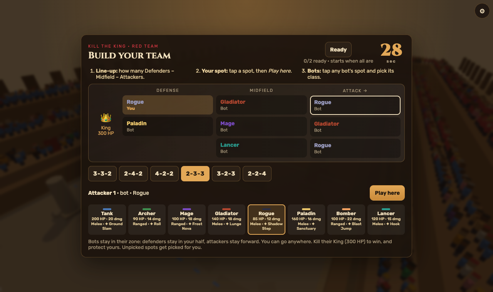
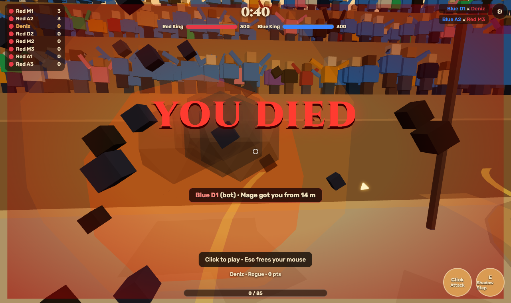
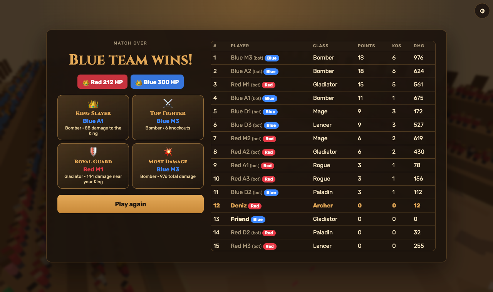

# Class Clash 3D

**Play it:** https://class-clash-3d-production.up.railway.app

A browser-based, third-person 3D multiplayer arena game. Friends join from any phone or laptop with a 4-letter room code: no login, no install. Pick from 8 classes and fight in a Roman colosseum, either King of the Hill or **Kill the King**, an 8v8 mode where you draft your line-up, pick a class for every bot on your team, and try to take down the enemy King.



## About this repo: AI competition project

I'm using this repository for an AI competition: the **Handshake AI Skills Studio × OpenAI Multiplayer Game Challenge** (entries due October 30, 2026). The challenge is to build a real-time multiplayer game that anyone can join from their own device with a room code, by guiding an AI through the design, build and debugging.

This repo is my working prototype and design reference for that project. It was built with AI assistance (Claude Code, by Anthropic): I made the design decisions (modes, classes, the draft, the King, the crowd, the finale) and directed and play-tested each change, and the AI wrote and tested the code. The challenge's official rules say the submitted project must be built in ChatGPT, so this repo is the reference, not the official entry.



| Draft your team | Knockouts | Results |
|---|---|---|
|  |  |  |

## Run it

```
npm install
npm start
```

Open http://localhost:3000. Other devices on the same Wi-Fi can join at `http://<your-computer's-IP>:3000`.

For quick testing, `ROUND_TIME=20 npm start` shortens rounds to 20 seconds.

## Live

https://class-clash-3d-production.up.railway.app (Railway). Redeploy with `railway up --service class-clash-3d --detach`.
Rooms live in server memory, so keep the service at **1 replica**: with more, players in the same room could land on different servers.

## Modes

- **Free-for-all / Teams:** King of the Hill in the colosseum (see Features).
- **Kill the King:** 8v8 on a long field (bots fill every empty spot). A 30 s draft (ends early when every human presses Ready): pick a line-up (Defenders–Midfield–Attackers, e.g. 3-3-2), take a spot, and choose a class for every bot. Each team has a slow 400 HP King with a 10 dmg short sword and an always-on aura: teammates within 5 m heal 4 HP/s, within 10 m move 20% faster. Kill theirs to win. Bot defenders cover their whole half, midfielders roam the map, attackers stay out of the back 25% of their half; humans go anywhere. Players who join mid-match take over a bot on the team with fewer humans; players who leave are replaced by a bot. Dying makes you explode ("YOU DIED"), then opens a death screen (10 s countdown, class swap, team stats, crowd vote) and you respawn on your 25% line. 5-minute rounds; if no King falls, the healthier King wins. Last 30 s = Final Frenzy: double damage, power-ups spawn 5x faster, 3 s respawns.
- **Squad commands (Kill the King):** you're the captain. During the fight any human can order the team's bots: **Z** ⚔ Attack (midfield and attackers push the enemy King; defenders hold), **X** 🛡 Defend the King (everyone hugs the King), **C** 🚩 Follow me, **V** 🎯 Focus (every bot hunts the enemy under your crosshair), **B** ↺ back to formation (📣 button on phones). Orders last 20 s (Focus 12 s), the latest one wins, and only your team sees them. Bots flash the order icon so you can see them obey. **King's Guard:** with 2+ teammates within 6 m, the King takes only 30% damage (gold dome, 🛡 on his health bar), and he always shrugs off half of splash damage, so defending is a real counter to an all-out push.
- **Close matches by design:** comeback bots quietly sharpen the trailing team's bots and soften the leading team's, so matches stay close. A tie (Kings within 5% health, or tied scores in the arena) goes to **Overtime**: health halved, damage ×2, speed ×2.
- **Easy to land hits:** a hit marker flashes on your crosshair when you connect (red on a knockout), and human players get a forgiving melee swing (wider cone, more reach, point-blank hits anything in front) plus slightly bigger projectile hitboxes. Bots use the plain numbers.
- **Also in every match:** a kill cam (the camera turns to whoever got you, with their name, class and distance), emotes (keys 1–4 or the 😀 button: wave, cheer, taunt, dance), Kill the King call-outs ("Your King is under attack!" plus an arrow to him), and soft background music (toggle it in ⚙ settings).
- **Scenery:** a sky with drifting clouds and distant mountains, a castle on the horizon (one per team behind each end in Kill the King), and a dragon that circles the stadium, breathes fire now and then, and swoops in with a roar for the Final Frenzy and the finale.
- **All modes:** a crowd of fans fills the stands and cheers on knockouts. Bots show "(bot)" under their names. The winning moment plays as a slow-motion finale (cinematic bars, winner banner, camera circling the fallen King or the winner) before MVP award cards and the results table. Knocked-out players (and knocked-out bots) vote where the next bonus power-up drops (every 12 s): Red side / Middle / Blue side (West / Middle / East in the colosseum). Every match gets a random pillar-and-wall layout (mirrored on the Kill the King field so it stays fair).

## Features

- 8 classes: Tank, Archer, Mage, Gladiator, Rogue, Paladin, Bomber, Lancer (each with an attack, a special and a passive; all numbers live in `shared/game.js`)
- Free-for-all or Teams: everyone starts split across Red and Blue and can switch to any of Red, Blue, Green or Gold in the lobby (no friendly fire)
- Bots fill empty seats, with Easy / Normal / Hard skill (aim wobble, reaction time, slower attacks, mistimed swings)
- King of the Hill: zone moves every 30 s with a 5 s warning; solo = 1 pt/s, contested = 0, KO = +3; 3-minute rounds, sudden death on ties
- Meteor shower in the last 45 s: red circles grow one at a time, then a meteor lands and knocks out anyone inside
- Power-ups: health bubble (+50% HP), sword (2x damage, 10 s), lightning (1.5x speed, 10 s)
- Gold star over the current leader
- Ranged attacks fly to the crosshair point (bombs arc onto it); light aim assist near enemies
- Hidden comeback boost after 3 deaths in a row without a kill (less damage taken, more dealt; fades after a kill)
- Server-authoritative: clients send inputs only; the server decides hits, HP, scores and the timer
- Client-side prediction for your own player, 100 ms interpolation for everyone else
- Laptop: WASD + mouse look (pointer lock), click = attack, E/right-click = special, Space = jump
- Phone (landscape): left joystick, drag right side to look, attack / special / jump buttons
- Invite links (`?room=CODE`) open straight into a join screen; locally they use the computer's Wi-Fi address
- Rejoin within 30 s with the same name keeps your score

## Files

- `server.js`: rooms, match loop (30 ticks/s), combat, bots
- `shared/game.js`: arena layout, class stats, movement physics (used by both server and client)
- `public/`: Three.js client (`main.js`), UI (`index.html`, `style.css`)
